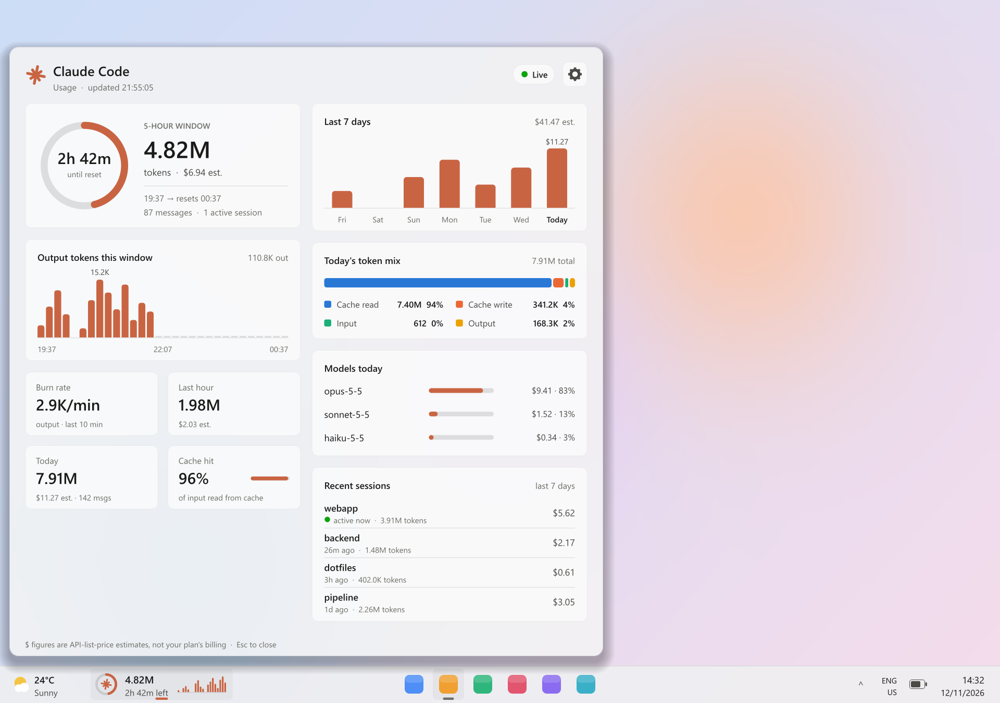
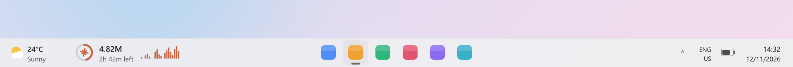
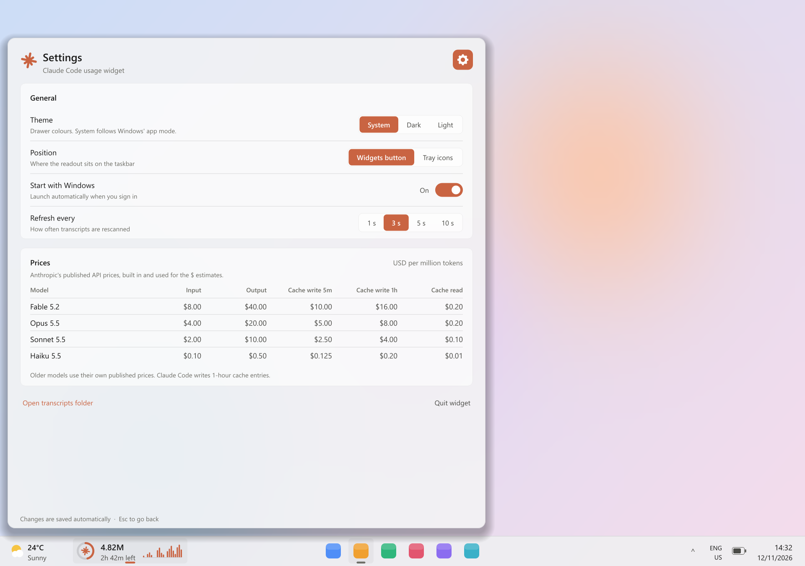

# Claude Code Usage Widget

A Windows 11 taskbar readout that shows your Claude Code usage in near real time.
Click it to slide in a detail panel. It's a single native `.exe` (about 1 MB)
written in Rust, with no runtime to install.

<p align="center">
  <picture>
    <source media="(prefers-color-scheme: dark)" srcset="docs/desktop-panel-dark.png">
    
  </picture>
</p>

<p align="center"><sub>Sample data on an illustrative desktop. Images follow your GitHub light/dark theme. <a href="#screenshots">More screenshots</a></sub></p>

- **Taskbar readout:** sits next to the Widgets (weather) button, or by the tray.
  It shows three things:
  - a ring for how much of the 5-hour usage window has passed
  - tokens used in the window and the time left until it resets
  - a sparkline of output tokens over the last 60 minutes
- **Drawer:** a frosted-glass panel that slides in from the screen edge. It shows:
  - a gauge for the 5-hour window and its activity chart
  - stat tiles: burn rate, last hour, today, and cache hit rate
  - cost per day for the last 7 days
  - today's token mix and usage per model
  - recent sessions

  The gear button at its top right switches the drawer to **Settings**.

All data comes from Claude Code's local transcripts (`~/.claude/projects/**/*.jsonl`,
or `$CLAUDE_CONFIG_DIR/projects`). Nothing is sent anywhere.

## Screenshots

All screenshots use sample data and follow your GitHub light/dark theme.

**On the taskbar.** The readout sits next to the Widgets (weather) button,
using the same glass as the taskbar.

<picture>
  <source media="(prefers-color-scheme: dark)" srcset="docs/taskbar-dark.png">
  
</picture>

**Readout close-up.** The ring shows how much of the 5-hour window has passed,
next to the tokens used, the time left, and output over the last hour.

<picture>
  <source media="(prefers-color-scheme: dark)" srcset="docs/readout-dark.png">
  
</picture>

**Drawer open.** Click the readout and the drawer slides in above the
taskbar. This is the whole screen as you'd see it.

<picture>
  <source media="(prefers-color-scheme: dark)" srcset="docs/desktop-panel-dark.png">
  
</picture>

**Drawer close-up.**

<p align="center">
  <picture>
    <source media="(prefers-color-scheme: dark)" srcset="docs/panel-dark.png">
    
  </picture>
</p>

**Settings.** Click the gear at the drawer's top right. Click it again, or
press **Esc**, to go back.

<picture>
  <source media="(prefers-color-scheme: dark)" srcset="docs/desktop-settings-dark.png">
  
</picture>

## Install

Download one of these from the [latest release](https://github.com/djluiso/claude-usage-widget/releases/latest):

| File | What it is |
|---|---|
| `ClaudeUsageWidget-<version>-setup.exe` | Setup wizard (recommended). Installs per-user with no admin prompt, adds a Start Menu entry, and has an optional **Start with Windows** checkbox. |
| `ClaudeUsageWidget-<version>.msi` | Windows Installer package for managed or scripted installs (`msiexec /i … /qn`). Per-user, no admin prompt. |
| `ClaudeUsageWidget-<version>-portable.zip` | Just the `.exe`. Unzip and run it. |

Both installers put the app in `%LOCALAPPDATA%\Programs\Claude Usage Widget`.
To uninstall, go to **Settings → Apps → Installed apps**.

Requires Windows 11 (x64).

## Use

- **Left-click** the readout to open or close the drawer. Right-clicking the
  readout does nothing, so it can't get in the way on the taskbar.
- Click the **gear** at the drawer's top right for **Settings**.
- Press **Esc** or click anywhere else to close the drawer. In Settings,
  **Esc** goes back to the usage view first.
- **Right-click inside the drawer** for a quick menu: dock position, theme,
  **Start with Windows**, open the transcripts folder, Settings, and quit.
- Launching the app again (for example from the Start Menu) while it's running
  opens the drawer on **Settings**.

## Start with Windows

You can turn this on in two ways:

- In the setup wizard, tick **Start with Windows**.
- In the widget, use the **Start with Windows** toggle in **Settings** (the
  gear in the drawer).

Both add a `ClaudeUsageWidget` value under
`HKCU\Software\Microsoft\Windows\CurrentVersion\Run`. To turn it off, use the
same toggle or disable it in Windows under **Settings → Apps → Startup**. Uninstalling
removes the entry.

## Themes

Pick a theme in the drawer's **Settings** (or right-click inside the drawer,
then **Theme**):

| Option | Drawer |
|---|---|
| **System** (default) | Follows Windows' app mode (**Settings → Personalization → Colors → Choose your default app mode**), and switches live when you change it |
| **Dark** | Always dark |
| **Light** | Always light |

The taskbar readout always matches the taskbar itself (Windows mode), so it
stays readable whatever the drawer theme is.

## Settings

Click the gear at the drawer's top right. Changes are saved as you make them.

- **General:** theme, position (next to the Widgets button or the tray icons),
  **Start with Windows**, and the refresh interval (1, 3, 5 or 10 seconds).
- **Prices:** a read-only table of the built-in prices (see below).
- **Open transcripts folder** and **Quit widget**.

Settings are stored in `%LOCALAPPDATA%\ClaudeUsageWidget\config.json`:

```json
{
  "dock": "left",
  "theme": "system",
  "refresh_ms": 3000
}
```

## Prices

The $ figures use Anthropic's published API prices
([pricing page](https://platform.claude.com/docs/en/about-claude/pricing)),
built into the app for every Claude model. There's nothing to configure.

- Each response is priced by its exact model, including dated ids such as
  `claude-sonnet-4-5-20250929`. An unknown model of a known family (for
  example a newer Opus) uses that family's current price.
- Cache writes are priced by duration. Claude Code writes 1-hour cache
  entries, which cost 2× input; 5-minute writes cost 1.25×.
- Haiku 5.5 prompts over 100K tokens use its higher long-prompt rate.

When Anthropic changes prices, a new release updates the table
([`src/pricing.rs`](src/pricing.rs)).

> **Note:** these are API list-price **estimates**, not what your Pro or Max
> subscription bills.

## Build from source

You need these tools:

- Rust (stable, MSVC toolchain)
- the Visual Studio C++ build tools
- for the installers: [Inno Setup 6](https://jrsoftware.org/isinfo.php) and the
  WiX 5 .NET tool (`dotnet tool install --global wix --version 5.0.2`)

```powershell
cargo build --release
# regenerate the README screenshots (sample data) into docs\
.\target\release\claude-usage-widget.exe --screenshots docs
iscc /DAppVersion=1.0.0 installer\setup.iss
wix build installer\widget.wxs -arch x64 -d Version=1.0.0 -o dist\ClaudeUsageWidget-1.0.0.msi
```

## Releasing

Releases are automatic. The [CI & Release workflow](.github/workflows/release.yml)
runs on every push and pull request.

1. **Checks:** `cargo fmt --check`, `cargo clippy -D warnings` and
   `cargo test`.
2. **Release:** on a push to `main` that passes the checks, if the `version` in
   `Cargo.toml` has no GitHub Release yet, the workflow builds the setup `.exe`,
   the `.msi`, the portable `.zip` and `SHA256SUMS.txt`. It then tags the commit
   `v<version>` and publishes the release.

So to ship, bump `version` in `Cargo.toml` (and run `cargo build` so
`Cargo.lock` updates), commit, and push. Commits that don't change the version
are checked but not released.

Run the same checks locally before pushing:

```powershell
cargo fmt --check
cargo clippy --all-targets -- -D warnings
cargo test
```

## How it works

- **Data:** the widget tails the transcript files incrementally and dedupes
  responses by message ID. It estimates the 5-hour window from message timing,
  so the reset time may differ slightly from Anthropic's own.
- **Placement:** the readout is a separate borderless window that sits on top
  of the taskbar. Windows 11 has no public API for adding items to the taskbar.
  The widget finds the Widgets button through UI Automation and sets the
  taskbar as the window's owner, so it stays above the taskbar.
- **Drawing:** everything is drawn with [tiny-skia](https://github.com/RazrFalcon/tiny-skia)
  and [ab_glyph](https://github.com/alexheretic/ab-glyph), using Segoe UI.
  Both windows are shown through `UpdateLayeredWindow` with per-pixel alpha,
  so the translucent taskbar glass shows through. The panel's glass effect is
  a blurred snapshot of the screen behind it, taken when it opens.
