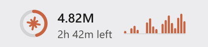
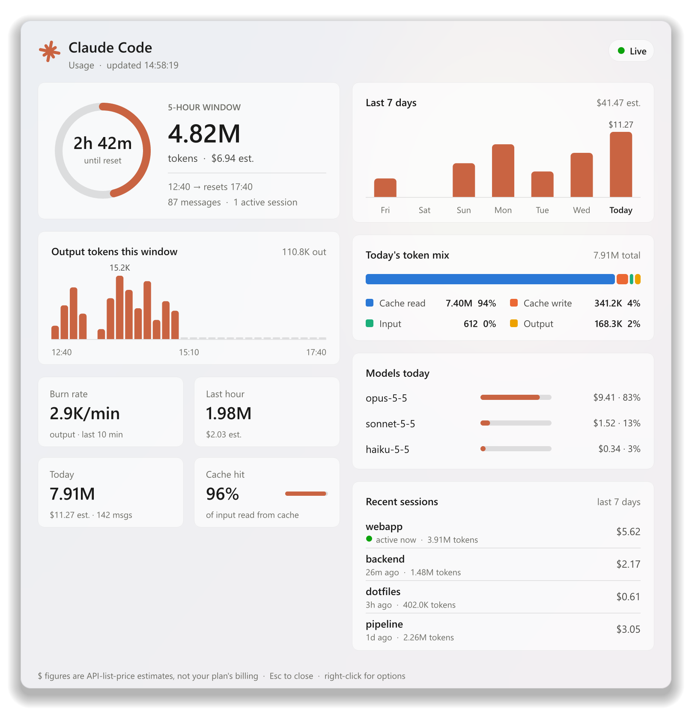

# Claude Code Usage Widget

A Windows 11 taskbar readout that shows your Claude Code usage in near real time.
Click it to slide in a detail panel. It's a single native `.exe` (about 1 MB)
written in Rust, with no runtime to install.

<p align="center">
  <picture>
    <source media="(prefers-color-scheme: dark)" srcset="docs/readout-dark.png">
    
  </picture>
</p>

<p align="center">
  <picture>
    <source media="(prefers-color-scheme: dark)" srcset="docs/panel-dark.png">
    
  </picture>
</p>

<p align="center"><sub>Screenshots use sample data. They switch between the dark and light themes with your GitHub theme.</sub></p>

- **Taskbar readout:** sits next to the Widgets (weather) button, or by the tray.
  It shows three things:
  - a ring for how much of the 5-hour usage window has passed
  - tokens used in the window and the time left until it resets
  - a sparkline of output tokens over the last 60 minutes
- **Detail panel:** a frosted-glass panel that slides in from the screen edge. It shows:
  - a gauge for the 5-hour window and its activity chart
  - stat tiles: burn rate, last hour, today, and cache hit rate
  - cost per day for the last 7 days
  - today's token mix and usage per model
  - recent sessions

All data comes from Claude Code's local transcripts (`~/.claude/projects/**/*.jsonl`,
or `$CLAUDE_CONFIG_DIR/projects`). Nothing is sent anywhere.

## Install

Download one of these from the [latest release](https://github.com/djluiso/claude-usage-widget/releases/latest):

| File | What it is |
|---|---|
| `ClaudeUsageWidget-<version>-setup.exe` | Setup wizard (recommended). Installs per-user with no admin prompt, adds a Start Menu entry, and has an optional **Start with Windows** checkbox. |
| `ClaudeUsageWidget-<version>.msi` | Windows Installer package for managed or scripted installs (`msiexec /i … /qn`). Per-user, no admin prompt. |
| `ClaudeUsageWidget-<version>-portable.zip` | Just the `.exe`. Unzip and run it. |

Both installers put the app in `%LOCALAPPDATA%\Programs\Claude Usage Widget`.
To uninstall, go to **Settings → Apps → Installed apps**.

Requires Windows 11 (x64).

## Use

- **Left-click** the readout to open or close the panel.
- In the panel, press **Esc** or click anywhere else to close it.
- **Right-click** the readout or the panel for the menu:
  - dock position (next to the Widgets button or next to the tray icons)
  - **Theme:** System, Dark or Light
  - **Start with Windows**
  - open the transcripts folder
  - edit settings
  - quit

## Start with Windows

You can turn this on in two ways:

- In the setup wizard, tick **Start with Windows**.
- In the widget, right-click the readout and check **Start with Windows**.

Both add a `ClaudeUsageWidget` value under
`HKCU\Software\Microsoft\Windows\CurrentVersion\Run`. To turn it off, uncheck
the menu item or disable it in **Settings → Apps → Startup**. Uninstalling
removes the entry.

## Themes

Pick a theme from the right-click menu under **Theme**:

| Option | Panel |
|---|---|
| **System** (default) | Follows Windows' app mode (**Settings → Personalization → Colors → Choose your default app mode**), and switches live when you change it |
| **Dark** | Always dark |
| **Light** | Always light |

The taskbar readout always matches the taskbar itself (Windows mode), so it
stays readable whatever the panel theme is.

## Settings

Settings live in `%LOCALAPPDATA%\ClaudeUsageWidget\config.json`. The file is
created on first run, and changes are picked up automatically.

```json
{
  "dock": "left",
  "theme": "system",
  "refresh_ms": 3000,
  "prices": {
    "opus":   [5.0, 25.0, 6.25, 0.5],
    "sonnet": [3.0, 15.0, 3.75, 0.3]
  }
}
```

`dock` is `"left"` or `"right"`, and `theme` is `"system"`, `"dark"` or `"light"`.
`prices` are USD per million tokens, in the order
`[input, output, cache write, cache read]`. They're matched against the model
name by substring.

> **Note:** dollar figures are API-list-price **estimates**, not what your
> subscription bills. Check them against https://claude.com/pricing.

## Build from source

You need these tools:

- Rust (stable, MSVC toolchain)
- the Visual Studio C++ build tools
- for the installers: [Inno Setup 6](https://jrsoftware.org/isinfo.php) and the
  WiX 5 .NET tool (`dotnet tool install --global wix --version 5.0.2`)

```powershell
cargo build --release
# regenerate the README screenshots (sample data) into docs\
.\target\release\claude-usage-widget.exe --screenshots docs
iscc /DAppVersion=1.0.0 installer\setup.iss
wix build installer\widget.wxs -arch x64 -d Version=1.0.0 -o dist\ClaudeUsageWidget-1.0.0.msi
```

## Releasing

1. Bump `version` in `Cargo.toml`.
2. Commit, then push a matching tag:

   ```powershell
   git tag v1.1.0
   git push origin v1.1.0
   ```

The [Release workflow](.github/workflows/release.yml) builds the setup `.exe`,
the `.msi`, the portable `.zip` and `SHA256SUMS.txt`, and attaches them to a
new GitHub Release.

## How it works

- **Data:** the widget tails the transcript files incrementally and dedupes
  responses by message ID. It estimates the 5-hour window from message timing,
  so the reset time may differ slightly from Anthropic's own.
- **Placement:** the readout is a separate borderless window that sits on top
  of the taskbar. Windows 11 has no public API for adding items to the taskbar.
  The widget finds the Widgets button through UI Automation and sets the
  taskbar as the window's owner, so it stays above the taskbar.
- **Drawing:** everything is drawn with [tiny-skia](https://github.com/RazrFalcon/tiny-skia)
  and [ab_glyph](https://github.com/alexheretic/ab-glyph), using Segoe UI.
  Both windows are shown through `UpdateLayeredWindow` with per-pixel alpha,
  so the translucent taskbar glass shows through. The panel's glass effect is
  a blurred snapshot of the screen behind it, taken when it opens.
