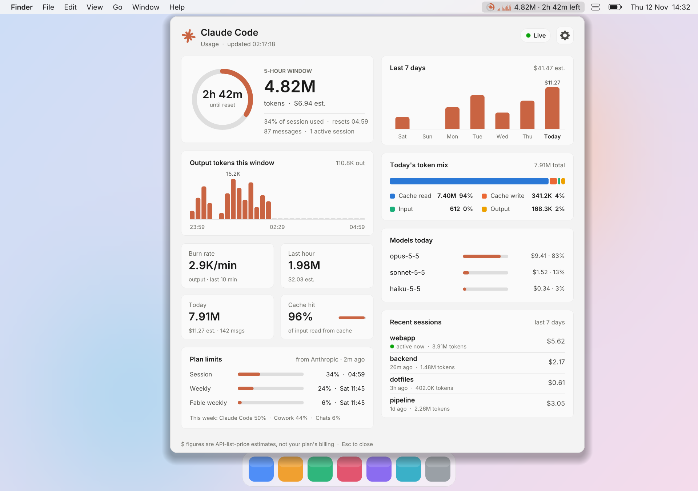
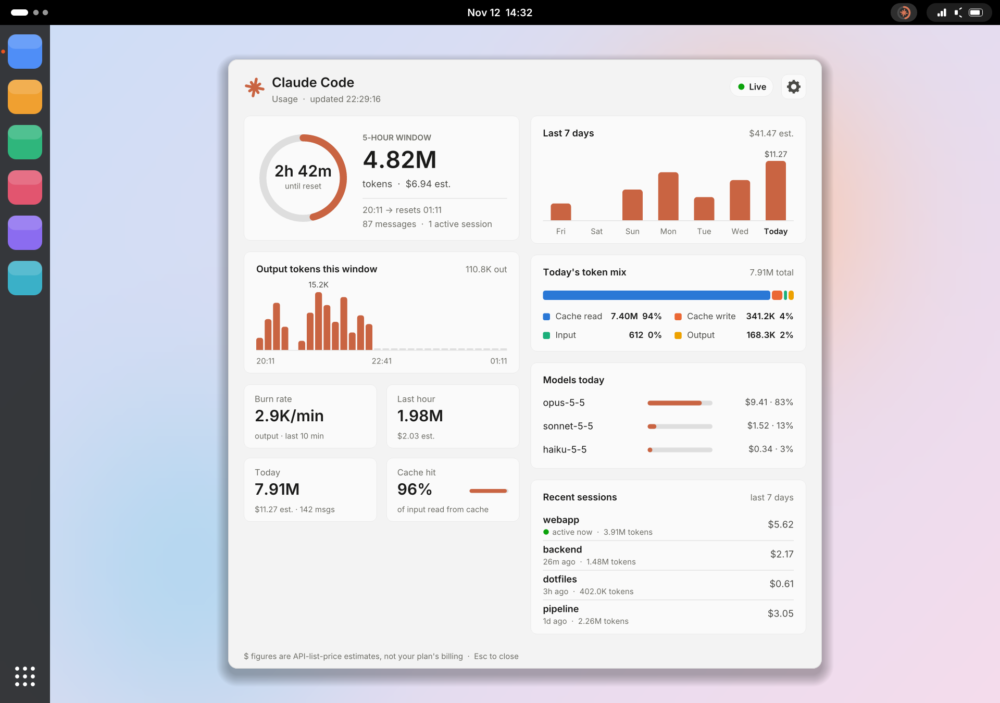

# Claude Code Usage Widget

A live readout of your Claude Code usage, with a detail drawer one click away:
on the **Windows 11 taskbar**, in the **macOS menu bar**, or in the
**Ubuntu / Linux tray**. It's a small native app written in Rust, with no
runtime to install.

| | Windows 11 | macOS | Ubuntu / Linux |
|---|---|---|---|
| Readout | On the taskbar, next to the Widgets button | Menu bar: ring icon, sparkline and token count | Tray icon with a tooltip |
| Screenshot | [At the top](#claude-code-usage-widget) | [macOS](#macos) | [Ubuntu](#ubuntu) |
| Drawer | Slides in from the screen edge, frosted glass | Drops down below the menu bar | Opens as a window |
| Status | Tested | [Not tested on a real Mac](#macos-1) | [Not tested on a real Ubuntu machine](#ubuntu--linux) |

<p align="center">
  <a href="https://ko-fi.com/djlou"></a>
  <a href="https://sociabuzz.com/djlou/tribe"></a>
</p>

<p align="center">
  <picture>
    <source media="(prefers-color-scheme: dark)" srcset="docs/desktop-panel-dark.png">
    
  </picture>
</p>

<p align="center"><sub>Windows 11, sample data. Images follow your GitHub light/dark theme. <a href="#screenshots">macOS and Ubuntu screenshots</a></sub></p>

- **Readout:** on the Windows taskbar (next to the Widgets button, or by the
  tray), in the macOS menu bar, or in the Linux tray. It shows:
  - a ring for how much of the 5-hour usage window has passed
  - tokens used in the window and the time left until it resets
  - a sparkline of output tokens over the last 60 minutes (Windows and macOS)
- **Drawer:** click the readout to open it. It shows:
  - a gauge for the 5-hour window and its activity chart
  - stat tiles: burn rate, last hour, today, and cache hit rate
  - cost per day for the last 7 days
  - today's token mix and usage per model
  - recent sessions

  The gear button at its top right switches the drawer to **Settings**.

- **Plan limits:** your real session and weekly limits, the same numbers
  Claude Code's `/usage` shows. They include usage on your phone, the web and
  other computers.

Token counts, costs and charts come from Claude Code's local transcripts
(`~/.claude/projects/**/*.jsonl`, or `$CLAUDE_CONFIG_DIR/projects`). The plan
limits come from Anthropic; see [Plan limits](#plan-limits) for exactly what
that involves, and how to turn it off.

## Screenshots

All screenshots use sample data and follow your GitHub light/dark theme. The
widget in each one is drawn by the app's own code; the desktop around it (bars,
docks, app icons) is a mock-up.

### Windows 11

The drawer open is shown [at the top](#claude-code-usage-widget). With it
closed, the readout sits on the taskbar next to the Widgets (weather) button,
in the taskbar's own glass:

<picture>
  <source media="(prefers-color-scheme: dark)" srcset="docs/taskbar-dark.png">
  
</picture>

Click the gear at the drawer's top right for **Settings**. Click it again, or
press **Esc**, to go back:

<picture>
  <source media="(prefers-color-scheme: dark)" srcset="docs/desktop-settings-dark.png">
  
</picture>

### macOS

The menu-bar item shows the ring, the sparkline and the token count. Click it
and the drawer drops down below it. (macOS draws the item's text in its own
system font.) [Not tested on a real Mac](#macos-1).

<picture>
  <source media="(prefers-color-scheme: dark)" srcset="docs/macos-dark.png">
  
</picture>

### Ubuntu

The tray icon sits in the top bar; hover over it for the token count. Click
it and the drawer opens where GNOME places new windows, usually the centre of
the screen. [Not tested on a real Ubuntu machine](#ubuntu--linux).

<picture>
  <source media="(prefers-color-scheme: dark)" srcset="docs/ubuntu-dark.png">
  
</picture>

## Install

Everything is on the [latest release](https://github.com/djluiso/claude-usage-widget/releases/latest) page.

### Windows

| File | What it is |
|---|---|
| `ClaudeUsageWidget-<version>-setup.exe` | Setup wizard (recommended). Installs per-user with no admin prompt, adds a Start Menu entry, and has an optional **Start with Windows** checkbox. |
| `ClaudeUsageWidget-<version>.msi` | Windows Installer package for managed or scripted installs (`msiexec /i … /qn`). Per-user, no admin prompt. |
| `ClaudeUsageWidget-<version>-portable.zip` | Just the `.exe`. Unzip and run it. |

Both installers put the app in `%LOCALAPPDATA%\Programs\Claude Usage Widget`.
To uninstall, go to **Settings → Apps → Installed apps**.

Requires Windows 11 (x64).

### macOS

> [!WARNING]
> **Not tested on a real Mac.** I've only used this widget myself on Windows.
> The macOS version is built, checked and screenshotted automatically on
> GitHub's macOS machines, but I haven't tried it personally on a real Mac.
> If something doesn't work, please
> [open an issue](https://github.com/djluiso/claude-usage-widget/issues).

1. Download `ClaudeUsageWidget-<version>-macos.dmg` (one app for Apple silicon
   and Intel Macs, macOS 11 or later).
2. Open it and drag **Claude Usage Widget** to **Applications**.
3. Open it from Applications. The app isn't notarized by Apple (that needs a
   paid developer account), so the first time macOS says it can't verify it:
   - click **Done**, open **System Settings → Privacy & Security**, scroll
     down and click **Open Anyway**; or
   - in Terminal, run
     `xattr -dr com.apple.quarantine "/Applications/Claude Usage Widget.app"`.

The readout appears in the menu bar at the top right. There's no Dock icon.
Click it to drop down the drawer. Turn on **Start at login** in Settings.

### Ubuntu / Linux

> [!WARNING]
> **Not tested on a real Ubuntu machine.** I've only used this widget myself
> on Windows. The Linux version is built, checked and screenshotted
> automatically on GitHub's Ubuntu machines, but I haven't tried it personally
> on a real Ubuntu PC. If something doesn't work, please
> [open an issue](https://github.com/djluiso/claude-usage-widget/issues).

For Ubuntu 24.04 or later (x86-64):

```sh
sudo apt install ./claude-usage-widget_<version>_amd64.deb
claude-usage-widget &
```

Or use `claude-usage-widget-<version>-linux-x86_64.tar.gz`, which holds just
the binary (needs GTK 4.12+).

- The readout is a tray icon. Ubuntu shows tray icons out of the box; KDE
  Plasma, Cinnamon (Linux Mint) and XFCE do too. On plain GNOME (for example
  Fedora), install the *AppIndicator and KStatusNotifierItem Support*
  extension first.
- Click the tray icon (or use its menu) to open the drawer. Hover over it for
  the token count.
- Linux desktops (Wayland) don't let apps choose where their windows open, so
  the drawer opens where the desktop puts new windows, not next to the icon.
- With no tray available, the drawer opens on its own when the app starts,
  and launching the app again opens it on **Settings**.

## Use

- **Left-click** the readout to open or close the drawer. Right-clicking the
  readout does nothing, so it can't get in the way on the taskbar.
- Click the **gear** at the drawer's top right for **Settings**.
- Press **Esc** or click anywhere else to close the drawer. In Settings,
  **Esc** goes back to the usage view first.
- **Right-click inside the drawer** for a quick menu: dock position, theme,
  **Start with Windows**, open the transcripts folder, Settings, and quit.
- Launching the app again (for example from the Start Menu) while it's running
  opens the drawer on **Settings**.

## Start with Windows

(On macOS and Linux it's the **Start at login** toggle in Settings. It adds a
LaunchAgent on macOS and an `~/.config/autostart` entry on Linux.)

On Windows you can turn this on in two ways:

- In the setup wizard, tick **Start with Windows**.
- In the widget, use the **Start with Windows** toggle in **Settings** (the
  gear in the drawer).

Both add a `ClaudeUsageWidget` value under
`HKCU\Software\Microsoft\Windows\CurrentVersion\Run`. To turn it off, use the
same toggle or disable it in Windows under **Settings → Apps → Startup**. Uninstalling
removes the entry.

## Themes

Pick a theme in the drawer's **Settings** (or right-click inside the drawer,
then **Theme**):

| Option | Drawer |
|---|---|
| **System** (default) | Follows Windows' app mode (**Settings → Personalization → Colors → Choose your default app mode**), and switches live when you change it |
| **Dark** | Always dark |
| **Light** | Always light |

The taskbar readout always matches the taskbar itself (Windows mode), so it
stays readable whatever the drawer theme is.

## Settings

Click the gear at the drawer's top right. Changes are saved as you make them.

- **General:** theme, position (Windows only: next to the Widgets button or
  the tray icons), **Start with Windows** / **Start at login**, the refresh
  interval (1, 3, 5 or 10 seconds), and
  [Plan limits from Anthropic](#plan-limits).
- **Prices:** a read-only table of the built-in prices (see below).
- **Open transcripts folder** and **Quit widget**.

Settings are stored in `config.json` in:

- Windows: `%LOCALAPPDATA%\ClaudeUsageWidget`
- macOS: `~/Library/Application Support/ClaudeUsageWidget`
- Linux: `~/.config/claude-usage-widget`


```json
{
  "dock": "left",
  "theme": "system",
  "refresh_ms": 3000,
  "plan_limits": true
}
```

## Plan limits

The transcripts only show Claude Code on this computer. Your plan's limits
also count the Claude apps on your phone and the web, Cowork, and other
computers, so the widget asks Anthropic for the numbers Claude Code's `/usage`
command shows:

- **Session:** the percentage of your 5-hour limit used, and when it resets.
  With this on, the readout's ring and "time left" use these real numbers
  instead of the estimate.
- **Weekly:** the percentage of your weekly limit used, and when it resets,
  plus any per-model weekly limit.
- **This week:** where the week's usage came from (Claude Code, Chats, Cowork).

How it works, and what it touches:

- It uses the login Claude Code already saved on this computer
  (`~/.claude/.credentials.json`; on macOS, the Keychain, and macOS asks once
  whether the widget may read it). You need a Pro or Max plan; with an API key
  there are no plan limits to show.
- It sends one request to Anthropic (`api.anthropic.com/api/oauth/usage`)
  every 5 minutes and when you open the drawer. The login is sent only to
  Anthropic and never stored by the widget.
- It never renews the login itself, so it can't sign Claude Code out. If the
  login has expired, the widget waits until Claude Code renews it.
- That request is the one `/usage` makes. Anthropic doesn't document it, so it
  may change; the widget then falls back to the local estimate.

Turn it off under **Settings → Plan limits from Anthropic**; the widget then
makes no network requests at all. To check it from a terminal, run
`claude-usage-widget --check-limits`. It prints your current percentages
(never the login).

## Prices

The $ figures use Anthropic's published API prices
([pricing page](https://platform.claude.com/docs/en/about-claude/pricing)),
built into the app for every Claude model. There's nothing to configure.

- Each response is priced by its exact model, including dated ids such as
  `claude-sonnet-4-5-20250929`. An unknown model of a known family (for
  example a newer Opus) uses that family's current price.
- Cache writes are priced by duration. Claude Code writes 1-hour cache
  entries, which cost 2× input; 5-minute writes cost 1.25×.
- Haiku 5.5 prompts over 100K tokens use its higher long-prompt rate.

When Anthropic changes prices, a new release updates the table
([`src/pricing.rs`](src/pricing.rs)).

> **Note:** these are API list-price **estimates**, not what your Pro or Max
> subscription bills.

## Build from source

Every platform needs Rust (stable). Useful switches for any build:
`--demo` shows sample data, `--open` opens the drawer at start, `--settings`
opens it on Settings, and `--screenshots <dir>` renders the README images.

**macOS:**

```sh
cargo build --release
installer/macos/build-app.sh 1.0.0   # universal .app and .dmg in dist/
```

**Ubuntu:**

```sh
sudo apt install libgtk-4-dev libdbus-1-dev pkg-config
cargo build --release
cargo install cargo-deb && cargo deb   # .deb package
```

**Windows.** You need these tools:

- Rust (stable, MSVC toolchain)
- the Visual Studio C++ build tools
- for the installers: [Inno Setup 6](https://jrsoftware.org/isinfo.php) and the
  WiX 5 .NET tool (`dotnet tool install --global wix --version 5.0.2`)

```powershell
cargo build --release
# regenerate the README screenshots (sample data) into docs\
.\target\release\claude-usage-widget.exe --screenshots docs
iscc /DAppVersion=1.0.0 installer\setup.iss
wix build installer\widget.wxs -arch x64 -d Version=1.0.0 -o dist\ClaudeUsageWidget-1.0.0.msi
```

## Releasing

Releases are automatic. The [CI & Release workflow](.github/workflows/release.yml)
runs on every push and pull request, on Windows, macOS and Ubuntu.

1. **Checks:** `cargo fmt --check`, `cargo clippy -D warnings` and
   `cargo test`, on all three systems.
2. **Preview:** runs the real app with sample data on GitHub's macOS and Ubuntu
   machines and saves screenshots, plus the README renders, as a downloadable
   `preview-macOS` / `preview-Linux` artifact on the run's page. This is how
   the macOS and Linux builds get looked at without owning those machines.
3. **Release:** on a push to `main` that passes the checks, if the `version` in
   `Cargo.toml` has no GitHub Release yet, the workflow builds:
   - Windows: the setup `.exe`, the `.msi` and the portable `.zip`
   - macOS: the `.dmg`
   - Linux: the `.deb` and the `.tar.gz`

   plus `SHA256SUMS.txt`. It then tags the commit `v<version>` and publishes
   the release.

So to ship, bump `version` in `Cargo.toml` (and run `cargo build` so
`Cargo.lock` updates), commit, and push. Commits that don't change the version
are checked but not released.

Run the same checks locally before pushing:

```powershell
cargo fmt --check
cargo clippy --all-targets -- -D warnings
cargo test
```

## Support

The widget is free. If it's useful to you, you can leave a tip:

- [Ko-fi](https://ko-fi.com/djlou)
- [SociaBuzz](https://sociabuzz.com/djlou/tribe)

The same links are at the bottom of the widget's **Settings**.

## How it works

- **Data:** the widget tails the transcript files incrementally and dedupes
  responses by message ID. Without [plan limits](#plan-limits), it estimates
  the 5-hour window from message timing, so the reset time may differ from
  Anthropic's own.
- **Placement:** the readout is a separate borderless window that sits on top
  of the taskbar. Windows 11 has no public API for adding items to the taskbar.
  The widget finds the Widgets button through UI Automation and sets the
  taskbar as the window's owner, so it stays above the taskbar.
- **macOS:** the readout is a menu-bar item ([tray-icon](https://github.com/tauri-apps/tray-icon)),
  and the drawer is a borderless window ([tao](https://github.com/tauri-apps/tao))
  whose image is shown through a Core Animation layer, keeping its
  transparency.
- **Linux:** the tray icon is a StatusNotifierItem ([ksni](https://github.com/iovxw/ksni)),
  and the drawer is a GTK 4 window.
- **Drawing:** everything is drawn with [tiny-skia](https://github.com/RazrFalcon/tiny-skia)
  and [ab_glyph](https://github.com/alexheretic/ab-glyph), so it looks the same
  everywhere. Windows uses Segoe UI; macOS and Linux use the bundled
  [Inter](https://rsms.me/inter/) font (SIL Open Font License). On Windows,
  both windows are shown through `UpdateLayeredWindow` with per-pixel alpha,
  so the translucent taskbar glass shows through. The panel's glass effect is
  a blurred snapshot of the screen behind it, taken when it opens.

## License

Copyright (C) 2026 djluiso

This program is free software: you can redistribute it and/or modify it under
the terms of the GNU General Public License as published by the Free Software
Foundation, either version 3 of the License, or (at your option) any later
version. See [LICENSE](LICENSE) for the full text.

In short: you're free to use, study, share and change it. If you share a
modified version, it has to stay open source under the same license, with the
original copyright kept.

The bundled [Inter](https://rsms.me/inter/) font is under the SIL Open Font
License ([assets/fonts/OFL.txt](assets/fonts/OFL.txt)).

